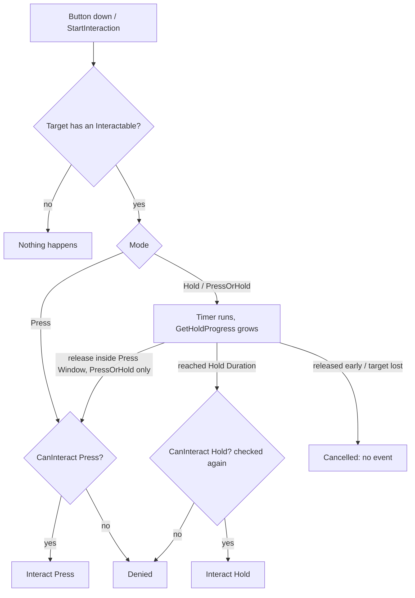

# Interaction System

A small, engine-native interaction system for [O3DE](https://o3de.org): *look at something, press or hold a button, something happens*.

It is built around two components: an **Interactor** (the one who acts: the player or an NPC) and an **Interactable** (the thing being acted upon: a door, an item, a lever). The gem only decides **whether** and **when** an interaction happens. **What** it does is up to you: a door opening, an item going into a backpack, a sound, a quest update. You connect it to your own components or to other gems from C++ or Script Canvas — see [Connecting to other gems and components](#connecting-to-other-gems-and-components).

- Works for players and NPCs: the Interactor takes a target entity and does not care how it was found.
- Three interaction modes per object: **Press**, **Hold**, or **Press or hold** (two different actions on one button).
- Any component or Script Canvas graph on the object can **veto** an interaction (a locked door) or **override its label** ("Open" / "Unlock").
- Hold progress (0..1) for UI, plus "done" / "denied" notifications.
- Ready for localization: every player-visible text (name and labels) is a **key + default text** pair. The gem only stores and passes it; whoever shows the text translates it, so the gem works with or without a localization gem — see [Labels for UI prompts](#labels-for-ui-prompts).
- No UI inside. An optional prompt with a hold-progress ring lives in a separate gem, [InteractionSystemUI](https://github.com/Dmytro-Personal-O3DE-Gems/InteractionSystemUI).

## Contents

- [Requirements](#requirements)
- [Installation](#installation)
- [Components](#components)
- [Quick start: player and a door](#quick-start-player-and-a-door)
- [Interaction modes](#interaction-modes)
- [How an interaction runs](#how-an-interaction-runs)
- [Connecting to other gems and components](#connecting-to-other-gems-and-components)
- [Blocking an interaction](#blocking-an-interaction)
- [Labels for UI prompts](#labels-for-ui-prompts)
- [Hold progress and results for UI](#hold-progress-and-results-for-ui)
- [NPCs](#npcs)
- [Bus reference](#bus-reference)
- [Status and roadmap](#status-and-roadmap)
- [License](#license)

## Requirements

| | |
|---|---|
| Engine | O3DE **26.05** (developed and tested against tag `2605.0`) |
| Gems | **StartingPointInput** (declared dependency; used by *Interactor Input*) |
| Physics | a physics gem (**PhysX**) enabled in the project: *Interaction Overlap Finder* raycasts through `AzPhysics::SceneInterface` |

## Installation

1. Clone the repository somewhere outside the engine, for example `D:\O3DE\UserGems\InteractionSystem`.
2. Register the gem with the engine:
   ```
   o3de register --gem-path D:\O3DE\UserGems\InteractionSystem
   ```
3. Enable it in your project: Project Manager → *Configure Gems* → **Interaction System**, or add `"InteractionSystem"` to `gem_names` in `project.json`.
4. Rebuild the project **with the Editor closed** (otherwise the linker cannot overwrite the gem's DLL).

To use the buses from your own C++ code, link the API target in your gem or project:

```cmake
BUILD_DEPENDENCIES
    PUBLIC   # PUBLIC if your header derives from one of the bus handlers, PRIVATE if only .cpp files include them
        Gem::InteractionSystem.API
```

and include the headers you need:

```cpp
#include <InteractionSystem/InteractableInterface.h>              // InteractableRequestBus, InteractableNotificationBus
#include <InteractionSystem/InteractorInterface.h>                // InteractorRequestBus, InteractorNotificationBus
#include <InteractionSystem/InteractionOverlapFinderInterface.h>  // target finder buses
#include <InteractionSystem/InteractionInfo.h>                    // InteractionInfo, InteractionMode, InteractionType
```

## Components

All components are in the **Interaction** category of the *Add Component* menu.

| Component | Put it on | What it does | Settings |
|---|---|---|---|
| **Interactor** | the character root (player or NPC) | Runs interaction attempts: checks, timing, notifications. One per entity. | **Press Window** (s, default 0.3) — for *Press or hold* objects: releasing within this time counts as a press |
| **Interactable** | the object | Marks the entity as interactable and describes it. One per entity. | **Interaction Info**: Display Name, Mode, On Press Label, On Hold Label, Hold Duration (s, default 1.0). The name and the labels each have a **Key** (for localization, may stay empty) and a **Default Text** |
| **Interaction Overlap Finder** | the camera (or an NPC's head) | Raycasts every tick along the entity's forward axis (+Y) and remembers the interactable in front of it. Ignores the owner's own colliders; walls block what is behind them. | **Owner Entity** — the character root (required); **Cast Distance** (m, default 2.0) |
| **Interactor Input** | the player's character root | Player only. Turns the `Interact` input event into "button down / button up" for the Interactor. Requires an Interactor on the same entity. | — |

Interactor Input listens to the input event named **`Interact`**. Add it to the input bindings (`.inputbindings`) used by the player's *Input* component and map it to a key, for example `keyboard_key_alphanumeric_E`.

## Quick start: player and a door

**Player** (character root):
1. **Input** (StartingPointInput) with bindings that contain an `Interact` event.
2. **Interactor**.
3. **Interactor Input**.

**Player camera** (child of the player):
4. **Interaction Overlap Finder**, *Owner Entity* = the player's root entity.

**Door**:
5. A collider (PhysX), so the ray can hit it.
6. **Interactable**: Mode = *Press*, On Press Label → Default Text = `Open` (Key = `door.open` if the project uses localization, otherwise leave it empty).
7. Something that reacts to `OnPressInteracted`: a Script Canvas graph or your own component (see [Connecting to other gems and components](#connecting-to-other-gems-and-components)).

Enter game mode, look at the door from closer than 2 m, press E.

> The finder addresses everything by the **owner** entity, not by the camera it sits on. The Interactor, the prompt UI and your scripts on the player all talk to it through the player's EntityId and never need to know where the camera is.

## Interaction modes

Set per object in *Interaction Info → Mode*. The two names to keep apart:

- `InteractionMode` — what an object **supports**: `Press`, `Hold`, `PressOrHold`.
- `InteractionType` — what actually **happened**: `Press` or `Hold`, never both.

| Mode | When it fires | Released early |
|---|---|---|
| **Press** | immediately on button down | — |
| **Hold** | when the button has been held for *Hold Duration* (without waiting for the release) | cancelled |
| **Press or hold** | release within *Press Window* → **Press**; held until *Hold Duration* → **Hold** | released after the window but before *Hold Duration* → cancelled |

Timeline of *Press or hold* with the defaults (window 0.3 s, hold 1.0 s):

```
button down          0.3 s                       1.0 s
    |------ press ------|------ cancel on release ------|-> Hold fires
```

Keep *Press Window* shorter than the shortest *Hold Duration*, otherwise a press can never happen.

## How an interaction runs



- A **Hold** attempt is checked twice: when it starts and again when the threshold is reached, because the state may change during the hold (the door got locked, someone else took the item).
- One attempt at a time: a second start while one is running is ignored.
- If the target changes or is lost during a hold, the attempt is cancelled. That includes the finder being deactivated (camera switch, cutscene).

Events at each outcome:

| Outcome | Interactable entity receives | Interactor entity receives |
|---|---|---|
| Done | `OnPressInteracted` / `OnHoldInteracted` | `OnInteractionDone(target, type)` |
| Denied | `OnInteractionRefused(interactor, type)` | `OnInteractionDenied(target, type)` |
| Cancelled | — | — |

## Connecting to other gems and components

This is the main way to use the gem. The Interactable only says *"someone interacted with me"*. What actually happens — an item goes into an inventory, a door opens, a quest advances — lives in **other** components, very often from **other gems** that know nothing about this one.

### The three hooks

Everything you connect goes through `InteractableNotificationBus`, addressed to the **object's own entity**:

| Hook | Event | Use it to | Details |
|---|---|---|---|
| **React** | `OnPressInteracted(interactor)` / `OnHoldInteracted(interactor)` | do something when the interaction happened | — |
| **Veto** | `OnCanInteractQuery(interactor, type)` → `bool` | forbid it (a locked door, a full inventory) | [Blocking an interaction](#blocking-an-interaction) |
| **Label** | `ReturnInteractableLabel(interactor, type)` → `LocalizedText` | change the prompt text ("Open" → "Unlock") | [Labels for UI prompts](#labels-for-ui-prompts) |
| *(optional)* | `OnInteractionRefused(interactor, type)` | react to a refused attempt (rattle the handle) | — |

`interactor` is the entity that acts (player or NPC). Pass it on to the other gem, for example *whose* inventory receives the item.

### The rule: glue lives in your project

```
InteractionSystem (gem)          Inventory (another gem)
          ▲                                ▲
          └────────── your project ────────┘
                (adapter component / graph)
```

- **Never edit the other gem**, and never make it depend on this one. You would lose the changes on its next update, and it would stop building without InteractionSystem.
- **Never make InteractionSystem depend on the other gem** either.
- Only your game project (or your own "glue" gem) knows about both, so the connection is written there.

There are two ways to write it: a small **C++ adapter component**, or a **Script Canvas graph**. Both sit on the **same entity as the Interactable**.

### Way 1: C++ adapter component

The example connects pick-up to an inventory from another gem. `Inventory::InventoryRequestBus`, `AddItem` and `Inventory/InventoryBus.h` are **example names**: use the real bus and header of the gem you connect.

**Step 1. Make both gems' headers visible to your code.** In your project's `Gem/CMakeLists.txt`, in the `${gem_name}.Private.Object` target (that is where project components are compiled):

```cmake
BUILD_DEPENDENCIES
    PUBLIC
        # The adapter's header derives from an InteractionSystem bus handler,
        # and the module includes that header to register the component.
        Gem::InteractionSystem.API
    PRIVATE
        # The other gem is used only inside the .cpp.
        Gem::Inventory.API
```

The `.API` target name of the other gem is in its `Code/CMakeLists.txt` (look for `NAME ${gem_name}.API`). Add the dependency to the target that compiles your `.cpp`. The error line shows the target name if you pick the wrong one.

**Step 2. Enable both gems in the project.** Use Project Manager → *Configure Gems*, or `gem_names` in `project.json`. CMake only makes the code **compile**. An enabled gem makes its components **exist at runtime**.

**Step 3. Write the adapter.**

`PickupToInventoryComponent.h`:

```cpp
#pragma once

#include <AzCore/Component/Component.h>
#include <InteractionSystem/InteractableInterface.h>

namespace MyGame
{
    //! Glue between InteractionSystem and the Inventory gem:
    //! pressing "interact" on this item puts it into the interactor's inventory.
    class PickupToInventoryComponent
        : public AZ::Component
        , public InteractionSystem::InteractableNotificationBus::Handler
    {
    public:
        AZ_COMPONENT_DECL(PickupToInventoryComponent);

        static void Reflect(AZ::ReflectContext* context);
        static void GetRequiredServices(AZ::ComponentDescriptor::DependencyArrayType& required);

    protected:
        // AZ::Component
        void Activate() override;
        void Deactivate() override;

        // InteractableNotificationBus: override only the events you need, the rest have empty defaults.
        void OnPressInteracted(AZ::EntityId interactorId) override;
    };
} // namespace MyGame
```

`PickupToInventoryComponent.cpp`:

```cpp
#include "PickupToInventoryComponent.h"

#include <AzCore/Serialization/SerializeContext.h>
#include <AzCore/Serialization/EditContext.h>

#include <Inventory/InventoryBus.h>   // the other gem's public header (example name)

namespace MyGame
{
    // Generate a new GUID for every component, never copy one.
    AZ_COMPONENT_IMPL(PickupToInventoryComponent, "PickupToInventoryComponent", "{00000000-0000-0000-0000-000000000000}");

    void PickupToInventoryComponent::Reflect(AZ::ReflectContext* context)
    {
        if (auto serializeContext = azrtti_cast<AZ::SerializeContext*>(context))
        {
            serializeContext->Class<PickupToInventoryComponent, AZ::Component>()
                ->Version(1);

            if (AZ::EditContext* editContext = serializeContext->GetEditContext())
            {
                editContext->Class<PickupToInventoryComponent>(
                    "Pickup To Inventory", "Puts this item into the interactor's inventory when it is interacted with.")
                    ->ClassElement(AZ::Edit::ClassElements::EditorData, "")
                    ->Attribute(AZ::Edit::Attributes::Category, "MyGame")
                    ->Attribute(AZ::Edit::Attributes::AppearsInAddComponentMenu, AZ_CRC_CE("Game"));
            }
        }
    }

    void PickupToInventoryComponent::GetRequiredServices(AZ::ComponentDescriptor::DependencyArrayType& required)
    {
        // The notifications are addressed to the Interactable's entity, so the adapter must sit on the same one.
        // With this line the editor refuses to add it anywhere else.
        required.push_back(AZ_CRC_CE("InteractableComponentService"));
    }

    void PickupToInventoryComponent::Activate()
    {
        // Listen to the Interactable on this entity.
        InteractionSystem::InteractableNotificationBus::Handler::BusConnect(GetEntityId());
    }

    void PickupToInventoryComponent::Deactivate()
    {
        InteractionSystem::InteractableNotificationBus::Handler::BusDisconnect();
    }

    void PickupToInventoryComponent::OnPressInteracted(AZ::EntityId interactorId)
    {
        // Call the other gem through its bus: no linking to its DLL is needed, only its header.
        Inventory::InventoryRequestBus::Event(interactorId, &Inventory::InventoryRequests::AddItem, GetEntityId());
    }
} // namespace MyGame
```

**Step 4. Register the files and the component.**
- Add both files to `Gem/<project>_files.cmake`.
- Register the descriptor in `Gem/Source/<Project>Module.cpp`. For a Standalone gem it goes in `<Gem>ModuleInterface.cpp`:

```cpp
#include "PickupToInventoryComponent.h"
// ...
m_descriptors.insert(m_descriptors.end(), {
    MyGame::PickupToInventoryComponent::CreateDescriptor(),
});
```

**Step 5. Build with the Editor closed.** Otherwise the linker cannot overwrite the project DLL.

**Step 6. Add the component to the item**, next to its Interactable, and test in game mode.

**Veto and label from C++.** Override the other two events in the same way. A door that needs a key from the inventory:

```cpp
bool LockedDoorComponent::OnCanInteractQuery(AZ::EntityId interactorId, InteractionSystem::InteractionType type)
{
    if (type != InteractionSystem::InteractionType::Press)
    {
        return true; // no objection to other actions
    }
    bool hasKey = false;
    Inventory::InventoryRequestBus::EventResult(hasKey, interactorId, &Inventory::InventoryRequests::HasItem, m_keyItemId);
    return hasKey;  // false blocks the interaction
}

InteractionSystem::LocalizedText LockedDoorComponent::ReturnInteractableLabel(
    AZ::EntityId interactorId, InteractionSystem::InteractionType type)
{
    if (type != InteractionSystem::InteractionType::Press)
    {
        return {};  // both fields empty = no opinion, the default label stays
    }
    bool hasKey = false;
    Inventory::InventoryRequestBus::EventResult(hasKey, interactorId, &Inventory::InventoryRequests::HasItem, m_keyItemId);

    InteractionSystem::LocalizedText label;
    label.m_key = hasKey ? "door.unlock" : "door.locked";   // leave empty if the project has no localization
    label.m_defaultText = hasKey ? "Unlock" : "Locked";
    return label;
}
```

`ReturnInteractableLabel` is called every frame while the door is targeted. Only read state there: no sounds, no logs, no changes. Return the key and the default text, **not** a translated string: translating is the UI's job (see [Labels for UI prompts](#labels-for-ui-prompts)).

### Way 2: Script Canvas graph

No C++ and no rebuild. It works only if the other gem's bus is **reflected to Script Canvas**.

**Step 1. Enable both gems in the project.** Same as Way 1, step 2.

**Step 2. Check that the other gem can be called from a graph.** Search for its bus or method name in the Script Canvas node palette. You can also look in its C++ `Reflect()` for `behaviorContext->EBus<...>(...)->Event(...)`. If it is not there, a graph cannot call it: use Way 1.

**Step 3. Create the graph on the object.** On the entity with the Interactable, add a **Script Canvas** component. Create a new graph and save it in your project's assets, for example `Assets/ScriptCanvas/PickupToInventory.scriptcanvas`. Assign it to the component.

**Step 4. Listen to the Interactable.** In the node palette, category **Interaction**, add the **InteractableNotificationBus** handler and add the event you need, for example **OnPressInteracted**.
- Leave its address as is: by default the handler listens to the entity that owns the graph, which is the object itself.
- **Do not connect anything to the handler's `Connect` pin.** A wire there permanently turns off its automatic connection to the graph's entity. The setting is saved in the graph and stays off even after the wire is removed. The graph then does nothing, with no error in game. If that happened, delete the handler node and add it again.

**Step 5. Call the other gem.** Connect the event's execution output (white arrow) to the other gem's node, for example `AddItem`. Feed the **Interactor** output into the pin that says *whose* inventory.

**Step 6. Test in game mode.** If the whole graph is silent, check the `.scriptcanvas` status in Asset Processor. The message "This graph defines no functions, it is never activated" means no handler is connected (see the `Connect` pin above).

**Veto in a graph:** add the **OnCanInteractQuery** event to the same handler node. It has an **input** Boolean pin — that is the graph's answer.
- **The checkbox is empty by default, which means `false` and blocks the interaction.** If the graph only observes, tick it.
- To answer from a graph variable: right-click the pin → **Convert to Reference** → pick the variable.
- The **Type** output is a plain `Number`. Compare it with the constants `InteractionType_Press` / `InteractionType_Hold`.
- During one hold, `CanInteract` is asked twice: at the start and at the threshold. So this event fires twice, which is expected.

**Label in a graph:** add **ReturnInteractableLabel**. Its answer is a **LocalizedText** value with *Key* and *DefaultText*: create one, fill the fields and connect it to the answer pin. Leave both fields empty for "no opinion". It is called every frame: no Print or other side effects there. (Overriding a label from a graph was tested while labels were plain strings; with `LocalizedText` it is not re-tested yet.)

### Which way to choose

| | C++ adapter | Script Canvas |
|---|---|---|
| Errors show up | at compile time | only at runtime |
| After a change | rebuild | instantly, no build |
| Debugging | normal debugger | harder, especially in big graphs |
| Requires | `.API` targets in CMake | the other gem's bus reflected to Script Canvas |
| Good for | reusable reactions: pick-ups, doors, locks | one-off scripted moments: "open this chest → cutscene" |

Both can be mixed: typical reactions in C++, unique ones in graphs. Several listeners on one object are fine. For example, a C++ lock and a graph that plays a sound both listen to the same door.

### Common mistakes

1. **The adapter or graph sits on another entity than the Interactable.** It hears nothing: the events are addressed to the Interactable's own entity.
2. **The collider is on a child entity, the Interactable on the parent.** The finder's ray returns the entity whose collider it hit. Put the Interactable on the entity with the collider.
3. **Two listeners return a label for the same action.** One wins at random and a warning is logged. A label must have one owner.
4. **A graph added "just to watch" blocks everything.** The *OnCanInteractQuery* checkbox was left empty (see above).
5. **"Just one line" in the other gem.** Don't: keep the glue in the project.

## Blocking an interaction

`CanInteract` asks every listener on the object through `OnCanInteractQuery(interactor, type)`. The answers are combined with a logical **AND**: one `false` blocks the interaction, the order of listeners does not matter.

- Return `true` when you have no objection, `false` to block. With no listeners at all the interaction is allowed.
- `type` lets you block one action and allow the other, for example allow *Press* (knock) but block *Hold* (lockpick) without a tool.
- In Script Canvas the handler node has an input pin for the answer: set it to `true` if the graph only observes.

A blocked attempt sends `OnInteractionRefused` to the object (play the "locked" rattle) and `OnInteractionDenied` to the interactor (update the UI).

## Labels for UI prompts

`InteractableRequests::GetInteractableLabel(interactor, type)` returns the label of one action as a `LocalizedText`, for example key `door.open` + default text `Open`.

1. It asks listeners on the object through `ReturnInteractableLabel(interactor, type)`. A non-empty answer overrides the default; an empty one (both fields empty) means "no opinion".
2. No answers → the default label from *Interaction Info* (*On Press Label* / *On Hold Label*).
3. Several answers → one of them is used and a warning is logged: a label must have **one owner**.

The label may depend on runtime state and on who is asking, for example "Unlock" if this interactor has the key, "Open" otherwise.

`ReturnInteractableLabel` is called **every frame** while the object is targeted. Keep it cheap and free of side effects: no sounds, no logs, no state changes.

### Localization: key + default text

Every player-visible text — *Display Name*, *On Press Label*, *On Hold Label* and the answers of `ReturnInteractableLabel` — is a `LocalizedText` (`InteractionSystem/InteractionInfo.h`):

| Field | Example | Meaning |
|---|---|---|
| `m_key` (*Key*) | `door.open` | what a localization system translates |
| `m_defaultText` (*Default Text*) | `Open` | shown when there is no translation, or no localization at all |

The gem **never translates**. It stores the pair and passes it on, and the code that shows the text decides. That way it does not depend on any localization gem. The expected way to show a `LocalizedText`:

| Key | Default Text | Show |
|---|---|---|
| empty | empty | nothing |
| empty | `Open` | `Open` as is (a game without localization) |
| `door.open` | `Open` | the translation of `door.open`; if there is none — `Open` |
| `door.open` | empty | the translation; if there is none — `door.open` itself (a loud hint that a string is missing) |

[InteractionSystemUI](https://github.com/Dmytro-Personal-O3DE-Gems/InteractionSystemUI) does exactly this. It asks for translations through the header-only [LocalizationContract](https://github.com/Dmytro-Personal-O3DE-Gems/LocalizationContract) gem, implemented for example by [LocalizationGem](https://github.com/Dmytro-Personal-O3DE-Gems/LocalizationGem). Without a localization gem it shows the default texts.

A game without localization simply leaves every *Key* empty.

## Hold progress and results for UI

- `InteractorRequests::GetHoldProgress()` returns `0..1` for the attempt in progress. Poll it every frame.
  - **Hold**: time held / *Hold Duration*.
  - **Press or hold**: 0 inside the press window, then counted from the end of the window, so a ring starts empty and reaches 1 exactly when the hold fires.
  - **Press** or no attempt: 0.
  - The value drops to 0 as soon as the attempt ends. Smoothing is up to the UI.
- `InteractorNotificationBus::OnInteractionDone` / `OnInteractionDenied` tell the UI that an attempt finished. A cancelled attempt sends neither.
- `InteractionOverlapFinderNotificationBus::OnTargetChanged(previous, new)` (addressed to the owner) is sent only when the target changes, including when it is lost (`new` is invalid) and when the finder is deactivated. To get the current target when your component starts, pull it once with `GetCurrentTarget()`, because no event is sent for a target that was already there.

A ready prompt built on these (rows per mode, labels, progress ring) is in [InteractionSystemUI](https://github.com/Dmytro-Personal-O3DE-Gems/InteractionSystemUI).

## NPCs

NPCs use the same **Interactor**, without the finder and without *Interactor Input*. The AI picks a target by its own means and drives the attempt directly:

```cpp
// Press, or Hold (the hold completes on its own after Hold Duration)
InteractionSystem::InteractorRequestBus::Event(npcId, &InteractionSystem::InteractorRequests::StartInteraction, doorId);

// Release: needed for a quick press on a "Press or hold" object, or to cancel a hold
InteractionSystem::InteractorRequestBus::Event(npcId, &InteractionSystem::InteractorRequests::StopInteraction);
```

All checks (`CanInteract`, votes) and notifications work the same as for the player. Reaction components receive the NPC's EntityId as the interactor, so they can tell the player and NPCs apart.

## Bus reference

All buses are reflected to Script Canvas and Lua (category *Interaction*). Enums are available as constants: `Mode_Press`, `Mode_Hold`, `Mode_PressOrHold`, `InteractionType_Press`, `InteractionType_Hold`. `LocalizedText` is a value type with the properties `Key` and `DefaultText` and the method `IsEmpty`.

| Bus | Address | Handled by | Calls / events |
|---|---|---|---|
| `InteractableRequestBus` | the object | Interactable (single handler) | `GetInteractionInfo`, `CanInteract(interactor, type)`, `GetInteractableLabel(interactor, type)` → `LocalizedText`, `Interact(interactor, type)` |
| `InteractableNotificationBus` | the object | your reaction components / graphs | `OnPressInteracted`, `OnHoldInteracted`, `OnInteractionRefused`, `OnCanInteractQuery` → bool (AND vote), `ReturnInteractableLabel` → `LocalizedText` |
| `InteractorRequestBus` | the interactor | Interactor (single handler) | `StartInteraction(target)`, `StartInteractionWithCurrentTarget()`, `StopInteraction()`, `GetHoldProgress()` |
| `InteractorNotificationBus` | the interactor | UI, sounds, achievements | `OnInteractionDone(target, type)`, `OnInteractionDenied(target, type)` |
| `InteractionOverlapFinderRequestBus` | the **owner** | Interaction Overlap Finder (single handler) | `GetCurrentTarget()` |
| `InteractionOverlapFinderNotificationBus` | the **owner** | UI, highlighting | `OnTargetChanged(previous, new)` |

`InteractionInfo` (the object's static description) is a plain struct. Runtime state such as "is it locked right now" does not belong there: answer it from `OnCanInteractQuery` / `ReturnInteractableLabel` instead.

## Status and roadmap

Tested in the editor with a player character: the three modes, labels (default, overridden from C++ by a door component, the warning for two owners), localized labels shown by InteractionSystemUI through LocalizationGem (switching languages at runtime), hold progress, done notifications, target loss when the finder is deactivated (exiting game mode).

Planned or not yet verified:
- **NPCs**: designed for, not tested yet (waits for AI).
- **Script Canvas labels**: overriding a label from a graph was tested while labels were plain strings; with `LocalizedText` it is not re-tested yet.
- `InteractorInputRequestBus` is an empty placeholder.

## License

[MIT](LICENSE) © 2026 Dmytro Shyshkin
